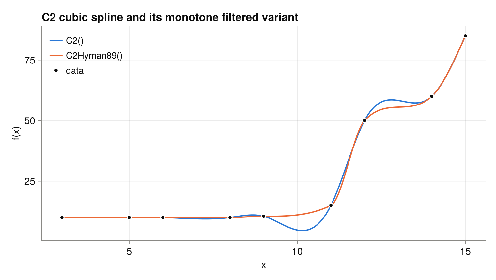
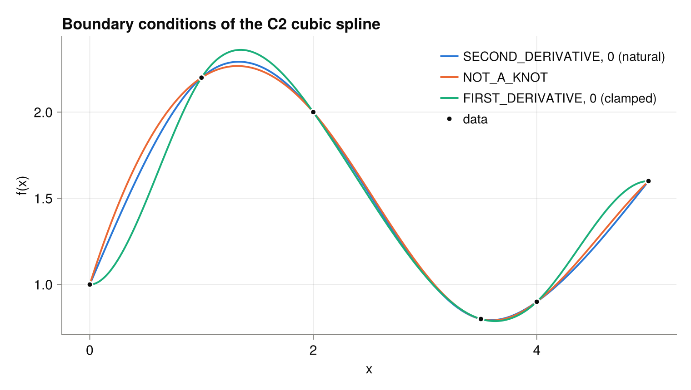
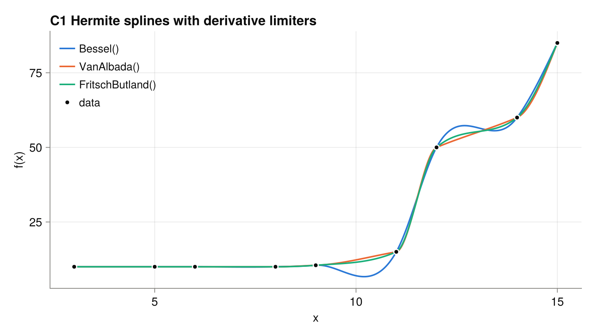
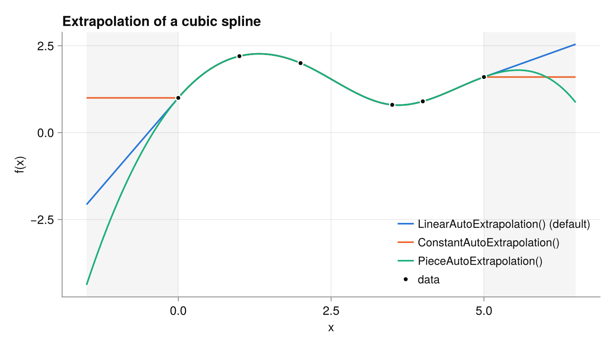
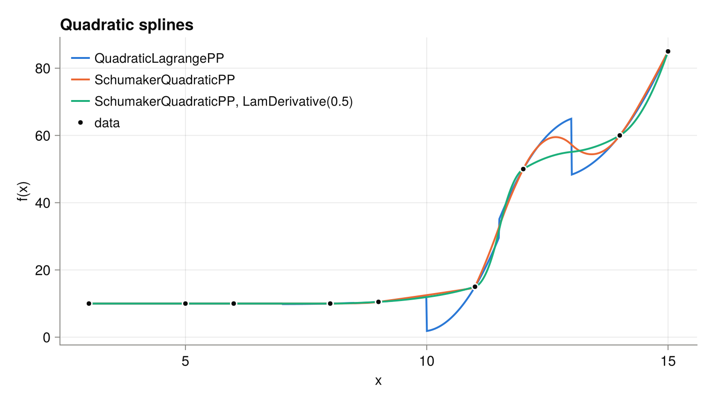
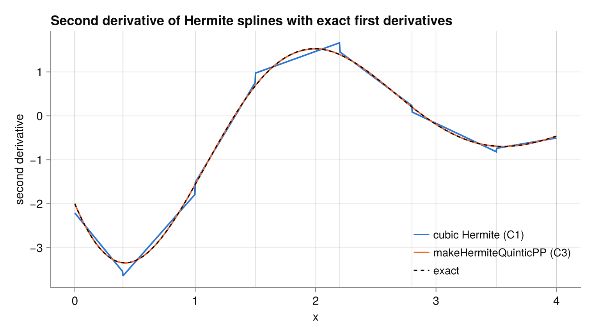

# Package PPInterpolation
| Status | Coverage |
| :----: | :----: |
| [](https://github.com/jherekhealy/PPInterpolation.jl/actions/workflows/julia-runtests.yml) | [](https://app.codecov.io/gh/jherekhealy/PPInterpolation.jl?branch=master) |


Piecewise polynomial interpolation in Julia following a straightforward implementation. This is mostly oriented towards various cubic spline interpolation:

* C2 cubic spline, eventually filtering out the first derivatives to ensure monotonicity.
* C1 Hermite spline with known first derivatives
* C1 Hermite spline with Bessel (parabolic) estimate of derivatives
* C1 Hermite spline using limiters such as VanLeer, VanAlbada, Huynh rational function, Fritsch-Butland (1980) harmonic mean, Fritch-Butland (1984) Brodlie formula.

with the following boundary conditions:

* first derivative at end point
* second derivative at end point
* not-a-knot
* first difference estimate at end point
 
Also supported are C3 Hermite quintic spline with  given first derivatives at all knots, plus second derivatives at end-points. 
Cubic and quintic Lavery splines are available in the package [Lavery.jl](https://github.com/jherekhealy/LaverySpline.jl).

Since version 0.7.4, the shape preserving quadratic spline of Larry L. Schumaker (1983) "On Shape Preserving Quadratic Spline Interpolation" has been added. It matches the values given by the Julia package [SchumakerSpline.jl](https://github.com/s-baumann/SchumakerSpline.jl) but allows to override the calculations of first derivatives, for example using the choice of Maria H. Lam (1990) "Monotone and Convex Spline Interpolation" guaranteeing a local, monotone and convex interpolation.


## Why another Julia interpolation package?
At the time this package was created (and still today), there are surprisingly few interpolation packages for Julia which support cubic splines. And the existing ones do not provide any control over the boundary conditions. The existing packages are not focused on cubic splines but tend to be more general.

* [Interpolations.jl](https://github.com/JuliaMath/Interpolations.jl) does not support C2 cubic splines with knots specified by a vector  (gridded in their terminology). 
* [DataInterpolations.jl](https://github.com/PumasAI/DataInterpolations.jl) does not support specifying endpoints conditions. 
* [Dierckx.jl](https://github.com/kbarbary/Dierckx.jl) is somewhat slow and supports only the standard C2 spline. It offers other features however, such as 2D splines.

This package support various boundary conditions (natural, not-a-knot, specific first or second derivatives), and not only C2 cubic splines but also C1 splines, monotonocity preserving splines. The flexible API allows to evaluate faster if we know the vector to evaluate is sorted.

Below is an example of performance using `x = sort(rand(500))` and `y=rand(500)` interpolating an array `z = collect(range(x[1],stop=x[end],length=500))`

| Package | Construction | Evaluation |
|:--------|--------------:|-----------------------:|
| Dierckx  Spline1D(x,y) | 48.692 μs (8 allocations: 97.11 KiB) |  21.405 μs (2 allocations: 4.09 KiB) |
| DataInterpolation CubicSpline(y,x) |  26.123 μs (524 allocations: 73.11 KiB) |21.591 μs (3 allocations: 4.14 KiB)|
| Interpolations interpolate(x,y,SteffenMonotonicInterpolation()) | 6.641 μs (5 allocations: 16.30 KiB) |   21.427 μs (3 allocations: 4.16 KiB)|
| PPInterpolation C2() | 21.610 μs (26 allocations: 89.41 KiB) | 15.503 μs (1 allocation: 48 bytes) |
| PPInterpolation C2() evaluateSorted|  | 4.670 μs (0 allocations: 0 bytes) |
| PPInterpolation VanAlbada() | 7.144 μs (13 allocations: 48.64 KiB) | 15.879 μs (1 allocation: 48 bytes) |
| PPInterpolation QuadraticLagrangePP(x,y) | 54.487 ns (1 allocation: 32 bytes) | 15.711 μs (1 allocation: 48 bytes) |
| PPInterpolation QuadraticLagrangePP(x,y) evaluateSorted! | |  2.942 μs (0 allocations: 0 bytes)|
| PPInterpolation SchumakerQuadraticPP(x,y) | 24.237 μs (83 allocations: 151.56 KiB) | 22.751 μs (5 allocations: 4.09 KiB)|
| PPInterpolation SchumakerQuadraticPP(x,y) evaluateSorted! | 24.237 μs (83 allocations: 151.56 KiB) | 4.823 μs (0 allocations: 0 bytes)|
| SchumakerSpline Schumaker(x,y) | 1.899 ms (23555 allocations: 8.64 MiB) |   51.600 μs (3005 allocations: 121.26 KiB) |

Note: Schumaker benchmark results have been done later on and timings are not strictly comparable with the other numbers.

## Examples
### Cubic spline interpolation
Interpolate f(x) at non-equistant knots with a cubic spline keeping continuity of class C2 (first and second derivatives continuous):

```julia
using PPInterpolation

x = [3.0, 5.0, 6.0, 8.0, 9.0, 11.0, 12.0, 14.0, 15.0]
f = [10.0, 10.0, 10.0, 10.0, 10.5, 15.0, 50.0, 60.0, 85.0]
spline = makeCubicPP(x, f, C2(), left = Natural(), right = Natural())
spline(4.0)
```

The boundary conditions `left` and `right` default to `Natural()` and may be any of `Natural()`, `NotAKnot()`, `FirstDifference()`, `FirstDerivative(value)` or `SecondDerivative(value)`.
The older positional form `makeCubicPP(x, f, PPInterpolation.SECOND_DERIVATIVE, 0.0, PPInterpolation.SECOND_DERIVATIVE, 0.0, C2())` is still supported.

The C2 spline overshoots around the sharp increase, while the filtered `C2Hyman89()` variant stays monotone:



The boundary conditions mostly change the spline on the first and last intervals:



Various monotonicity preserving scheme are available by changing the last parameter `C2()` to

* `C2Hyman89()` : the first derivatives are adjusted to preserve monotonicity according to Dougherty and Hyman "Nonnegativity-, Monotonicity-, or Convexity-Preserving Cubic and Quintic Hermite Interpolation" (1989).
* `C2MP()` : adjust first derivatives according to the simplest monotonicity preserving scheme. See Huynh "Accurate Monotone Cubic Interpolation" (1991).
* `C2MP2()` : adjust first derivatives according to the extended monotonicity preserving scheme. See Huynh "Accurate Monotone Cubic Interpolation" (1991).
* `HuynRational()` : the first derivatives are estimated through a rational function which guarantees monotonicity. See Huynh "Accurate Monotone Cubic Interpolation" (1991).
* `VanAlbada()` : Van Albada type of approximation for the first derivatives. See Huynh "Accurate Monotone Cubic Interpolation" (1991).
* `VanLeer()` : Van Leer type of approximation for the first derivatives. See Huynh "Accurate Monotone Cubic Interpolation" (1991).
* `FritschButland()`  : the first derivatives are estimated through a weighted harmonic mean which guarantees monotonicity.
* `Brodlie()` : similar to FritchButland but takes into account the non-uniformity of the knots better, see Fritsch and Butland "A method for constructing local monotone piecewise cubic interpolants"  (1984).

Other C1 choices of first derivatives, which do not preserve monotonicity:

* `Bessel()` : the derivative of the parabola through three consecutive points.
* `Fukasawa()` : equal incidence and reflection angles, see Fukasawa et al. (2011) "Model-free implied volatility: from surface to index".
* `Hermite(b)` : the given first derivatives `b` at the knots.

and `C2HymanNonNegative()` adjusts the C2 spline first derivatives to preserve non-negativity of the data.

For the C1 schemes, the `NOT_A_KNOT` boundary condition is approximated by the derivative of the parabola through the three first (or last) points. It is not limited, and may thus break monotonicity on the first or last interval. Use `FIRST_DIFFERENCE` or `SECOND_DERIVATIVE` to keep monotonicity.

The limiters produce C1 Hermite splines. Unlike the parabolic `Bessel()` estimate, they preserve monotonicity:



The spline may be evaluated beyond the original range for `x`. The extrapolation is given when building the spline, and defaults to a linear extrapolation using the value and slope at the end-points:
```julia
spline = makeCubicPP(x, f, C2(), extrapolation = ConstantAutoExtrapolation())
spline(20.0) # 85.0
```
`PieceAutoExtrapolation()` uses the first/last polynomial piece and `ZeroExtrapolation()` is zero beyond the end-points. All spline constructors accept the `extrapolation` keyword.
The extrapolation of an existing spline is changed with `PP(spline, extrapolation = PieceAutoExtrapolation())`, or for a single evaluation with `evaluate(spline, 20.0, extrapolation = PieceAutoExtrapolation())`.



### Derivatives and integrals
The first, second and third derivatives of a spline are evaluated with `evaluateDerivative(spline, z)`, `evaluateSecondDerivative(spline, z)` and `evaluateThirdDerivative(spline, z)`, consistently with the extrapolation. The integral of the spline between `z1` and `z2` (within the knots) is `evaluateIntegral(spline, z1, z2)`.

### Quadratic Lagrange interpolation
Quadratic Lagrange interpolation has fast evaluation API with mutable variable:

```julia
using PPInterpolation

x = [3.0, 5.0, 6.0, 8.0, 9.0, 11.0, 12.0, 14.0, 15.0]
f = [10.0, 10.0, 10.0, 10.0, 10.5, 15.0, 50.0, 60.0, 85.0]
spline = QuadraticLagrangePP(x, f)
spline(4.0)
y = Array{Float64}(undef, 100) #the output
z = collect(range(3.0,stop=15.0,length=100)) #this is sorted input
evaluateSorted!(spline,y,z)
```

`convert(PP, spline)` gives the equivalent piecewise quadratic polynomial, to use the integration and extrapolation features.

### Schumaker quadratic spline interpolation
`SchumakerQuadraticPP` implements the shape preserving quadratic spline of Larry L. Schumaker (1983) "On Shape Preserving Quadratic Spline Interpolation". It matches the values given by the Julia package [SchumakerSpline.jl](https://github.com/s-baumann/SchumakerSpline.jl) but allows to override the calculations of first derivatives, for example using the choice of Maria H. Lam (1990) "Monotone and Convex Spline Interpolation" guaranteeing a local interpolation.

The spline preserves convexity. Monotonicity is preserved only if the first derivatives at the knots are consistent with it: this is guaranteed with `LamDerivative`, but not with the default `SchumakerDerivative()` estimate, which may slightly overshoot on monotone data.

```julia
using PPInterpolation

x = [3.0, 5.0, 6.0, 8.0, 9.0, 11.0, 12.0, 14.0, 15.0]
f = [10.0, 10.0, 10.0, 10.0, 10.5, 15.0, 50.0, 60.0, 85.0]
spline = SchumakerQuadraticPP(x, f, LamDerivative(0.5))
spline(4.0)
y = Array{Float64}(undef, 100) #the output
z = collect(range(3.0,stop=15.0,length=100)) #this is sorted input
evaluateSorted!(spline,y,z)
```

The quadratic Lagrange interpolation is local and not continuous at the mid-points between knots, while the Schumaker spline is C1. With `LamDerivative(0.5)`, it is also monotone on this example:



### Quintic Hermite spline interpolation
`makeHermiteQuinticPP` builds a C3 quintic spline from the values and first derivatives at the knots, plus optionally the second derivatives at the end-points:

```julia
using PPInterpolation

g(t) = exp(-t / 2) * sin(2t)
g1(t) = exp(-t / 2) * (2cos(2t) - sin(2t) / 2)
g2(t) = exp(-t / 2) * (-15sin(2t) / 4 - 2cos(2t))
x = [0.0, 0.4, 1.0, 1.5, 2.2, 2.8, 3.5, 4.0]
spline = makeHermiteQuinticPP(x, g.(x), g1.(x), g2(x[1]), g2(x[end]))
evaluateSecondDerivative(spline, 1.2)
```

Compared to the C1 cubic Hermite spline with the same first derivatives, the second derivative is continuous and much closer to the exact one:



### B-spline conversion
When the package [BSplines.jl](https://github.com/sostock/BSplines.jl) is loaded, quadratic and cubic splines may be converted to and from a B-spline representation with `convert(BSplines.Spline, spline)` and `convert(PP{3,Float64,Float64}, bspline)`.

The figures are generated by `julia --project=examples examples/readme_plots.jl`.